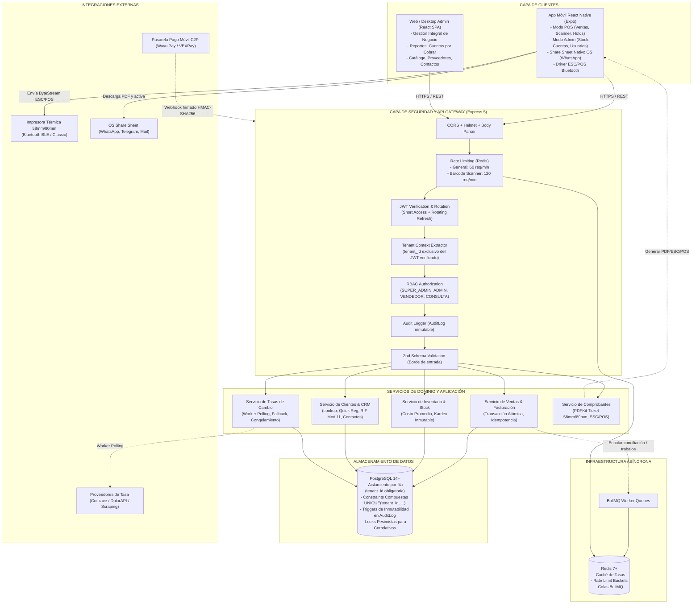
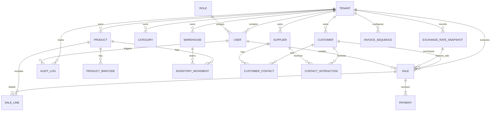
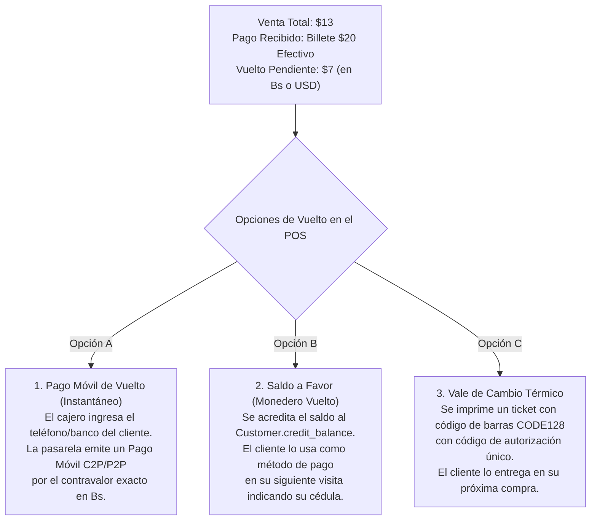

# FASE 0: ARQUITECTURA, MODELO DE DATOS Y DECISIONES TÉCNICAS
## Plataforma SaaS Multi-Tenant: **Vuelto**
**Documento de Arquitectura y Especificación de Sistema (v6.0)**
*Fecha: Noviembre 2026 | Estado: Propuesta para Aprobación*

---

## 1. RESUMEN EJECUTIVO Y VISIÓN DEL PRODUCTO "VUELTO"

**Vuelto** es una plataforma SaaS multi-tenant concebida específicamente para resolver la realidad operativa y fiscal de los pequeños y medianos comercios en Venezuela (bodegas, abastos, ferreterías, farmacias, tiendas de conveniencia y minimarkets). 

El sistema ataca los dolores neurálgicos del mostrador venezolano:
1. **Facturación ultrarrápida móvil (Modo POS):** Escaneo con cámara del código de barras original del fabricante, cálculo bimoneda (USD / VEF) a tasa oficial congelada, y soporte de múltiples cuentas abiertas en cola simultánea sin perder el hilo de venta.
2. **El problema del "vuelto":** Soporte de pagos mixtos (Efectivo USD + Pago Móvil + Débito) y registro transparente de vueltos, ya sea mediante vuelto en Pago Móvil, saldo a favor en cuenta de cliente o vale de cambio.
3. **Módulo Administrativo Dual:** Administración completa desde Web/Escritorio y administración esencial desde la misma App Móvil para usuarios con rol `ADMIN` (ajustes de stock, cobro de deudas, consulta de historial y gestión de vendedores).
4. **Cumplimiento estricto pero desacoplado:** Arquitectura adaptada a las Providencias SENIAT 0071/102 y SNAT/2024/000121, con numeración correlativa sin saltos, desglose de bases imponibles y cálculo de IGTF (3%).
5. **Cero costos ocultos en mensajería:** Eliminación total de APIs complejas y costosas de WhatsApp (Meta Cloud API). Envío directo de comprobantes PDF mediante el *Share Sheet* nativo del sistema operativo móvil.

---

## 2. ADVERTENCIA FORMAL DE CUMPLIMIENTO FISCAL VENEZOLANO (SENIAT)

> [!WARNING]
> ### REQUISITO LEGAL MANDATORIO: HOMOLOGACIÓN SENIAT
> Conforme a la **Providencia Administrativa SNAT/2024/000121** (Gaceta Oficial N° 42.884 del 22 de mayo de 2024), **ningún proveedor de software puede comercializar, arrendar o implementar sistemas computarizados o automatizados de facturación en Venezuela sin contar con la debida AUTORIZACIÓN Y HOMOLOGACIÓN previa emitida por el SENIAT**.
>
> 1. **Riesgo Legal Directo:** La operación o distribución comercial de un software de facturación no homologado acarrea sanciones estipuladas en el Código Orgánico Tributario (COT), que incluyen clausura de establecimientos (comercio y proveedor de software), comiso de equipos informáticos y multas severas de hasta 1.000 veces el tipo de cambio oficial de la moneda de mayor valor fijada por el BCV.
> 2. **Doble Naturaleza del Software en el Roadmap:**
>    - **Fase de Desarrollo y Pruebas (Uso Pre-Homologación):** El sistema debe emitir comprobantes claramente rotulados como **"COMPROBANTE NO FISCAL - ORDEN DE DESPACHO / NOTA DE ENTREGA"** hasta que el trámite formal de homologación haya sido completado ante la Gerencia de Fiscalización del SENIAT.
>    - **Fase de Homologación Formal:** Se debe presupuestar desde el inicio la contratación de una firma de asesoría legal-tributaria venezolana y la preparación de la carpeta técnica (manual de usuario, manual técnico de auditoría, diagrama de seguridad, inmutabilidad de bases de datos y pruebas de laboratorio SENIAT).

### Requisitos Técnicos y Operativos Exigidos por el Marco Fiscal Venezolano (Providencia 0071/102 y Normativa IGTF)

1. **Numeración Consecutiva sin Saltos (Continuidad Numérica):**
   - El número de factura fiscal debe ser estrictamente secuencial, único por serie y sucursal/tenant, sin huecos ni duplicados.
   - **Impacto Arquitectural:** La factura se genera **únicamente** en el momento atómico de confirmación del pago. Las cuentas en espera (*Held Carts*), presupuestos o carritos temporales **jamás generan un correlativo fiscal ni descuentan stock**.
2. **Estructura Desglosada Obligatoria en Factura:**
   - Datos del Emisor: Razón social, RIF, domicilio fiscal.
   - Datos del Receptor: Nombre/Razón Social, Cédula o RIF (validado bajo algoritmo Módulo 11), domicilio fiscal y teléfono.
   - Discriminación de Alícuotas de IVA:
     - Base Imponible Gravada al 16% (Alícuota General) y su IVA.
     - Base Imponible Gravada al 8% (Alícuota Reducida) y su IVA.
     - Base Imponible Exenta / No Sujeta (0%).
     - **Regla Estricta:** No se permite mostrar únicamente precios con "IVA incluido" sin discriminar base imponible e impuesto en el pie del documento.
3. **Impuesto a las Grandes Transacciones Financieras (IGTF - 3%):**
   - Según la Ley de Reforma Parcial del IGTF (Gaceta Oficial N° 6.687 Extraordinario), los comercios calificados como Sujetos Pasivos Especiales (Contribuyentes Especiales) que reciban pagos en divisas (USD efectivo) o criptomonedas distintas al Petro están obligados a percibir el **3% de IGTF**.
   - El sistema debe desglosar la base del pago en divisas y el importe del 3% percibido en la factura y reflejarlo en los totales.
4. **Desacoplamiento del Dominio Fiscal y Comercial:**
   - La venta comercial en el sistema posee el ciclo de vida `SaleStatus` (`COMPLETED`, `CANCELLED`).
   - La transmisión o reporte fiscal posee un ciclo independiente `FiscalStatus` (`PENDING`, `TRANSMITTED`, `ACCEPTED`, `REJECTED`, `EXEMPT_NON_FISCAL`). De esta forma, si el enlace con un dispositivo fiscal o con el servidor de remisión electrónica falla, la operación comercial no se bloquea indebidamente.

---

## 3. ARQUITECTURA GENERAL DEL SISTEMA MULTI-TENANT

### Diagrama de Arquitectura de Vuelto



---

## 4. MODELO DE DATOS NÚCLEO (POSTGRESQL 14+)

El modelo implementa **aislamiento estricto por fila**: toda tabla de negocio contiene la columna `tenant_id` y claves únicas compuestas. Las tablas históricas (`AuditLog`, `ContactInteraction`) poseen disparadores a nivel de base de datos que impiden operaciones de `UPDATE` y `DELETE`.



### 4.1. Definición Detallada de Tablas y Esquemas DDL

#### A. Aislamiento y Control de Acceso (Tenancy & RBAC)

```sql
-- 1. Tenants (Negocios / Comercios)
CREATE TABLE tenants (
    id UUID PRIMARY KEY DEFAULT gen_random_uuid(),
    slug VARCHAR(50) UNIQUE NOT NULL,
    business_name VARCHAR(150) NOT NULL, -- Razón Social
    trade_name VARCHAR(150) NOT NULL,    -- Nombre Comercial (ej. "Bodega Don Pedro")
    document_type VARCHAR(2) NOT NULL CHECK (document_type IN ('J', 'G', 'V', 'E')),
    document_number VARCHAR(12) NOT NULL, -- RIF ej. J-12345678-9
    fiscal_address TEXT NOT NULL,
    phone VARCHAR(20) NOT NULL,
    email VARCHAR(100) NOT NULL,
    is_special_taxpayer BOOLEAN DEFAULT FALSE NOT NULL, -- Contribuyente Especial (aplica IGTF)
    internal_barcode_prefix VARCHAR(5) DEFAULT '200' NOT NULL, -- Prefijo para balanza/granel
    is_active BOOLEAN DEFAULT TRUE NOT NULL,
    created_at TIMESTAMPTZ DEFAULT NOW() NOT NULL,
    updated_at TIMESTAMPTZ DEFAULT NOW() NOT NULL,
    CONSTRAINT uq_tenant_rif UNIQUE (document_type, document_number)
);

-- 2. Roles del Sistema
CREATE TABLE roles (
    id VARCHAR(30) PRIMARY KEY, -- 'SUPER_ADMIN', 'ADMIN', 'VENDEDOR', 'CONSULTA'
    name VARCHAR(50) NOT NULL,
    description TEXT
);

-- 3. Users (Usuarios con pertenencia estricta a un Tenant)
CREATE TABLE users (
    id UUID PRIMARY KEY DEFAULT gen_random_uuid(),
    tenant_id UUID NOT NULL REFERENCES tenants(id) ON DELETE RESTRICT,
    role_id VARCHAR(30) NOT NULL REFERENCES roles(id) ON DELETE RESTRICT,
    username VARCHAR(50) NOT NULL,
    email VARCHAR(100) NOT NULL,
    password_hash VARCHAR(255) NOT NULL,
    full_name VARCHAR(100) NOT NULL,
    phone VARCHAR(20),
    is_active BOOLEAN DEFAULT TRUE NOT NULL,
    last_login_at TIMESTAMPTZ,
    created_at TIMESTAMPTZ DEFAULT NOW() NOT NULL,
    updated_at TIMESTAMPTZ DEFAULT NOW() NOT NULL,
    CONSTRAINT uq_tenant_username UNIQUE (tenant_id, username),
    CONSTRAINT uq_tenant_user_email UNIQUE (tenant_id, email)
);
CREATE INDEX idx_users_tenant_role ON users(tenant_id, role_id);
```

#### B. Catálogo e Inventario

```sql
-- 4. Categorías de Producto
CREATE TABLE categories (
    id UUID PRIMARY KEY DEFAULT gen_random_uuid(),
    tenant_id UUID NOT NULL REFERENCES tenants(id) ON DELETE CASCADE,
    name VARCHAR(80) NOT NULL,
    description TEXT,
    is_active BOOLEAN DEFAULT TRUE NOT NULL,
    created_at TIMESTAMPTZ DEFAULT NOW() NOT NULL,
    CONSTRAINT uq_tenant_category_name UNIQUE (tenant_id, name)
);

-- 5. Almacenes / Depósitos
CREATE TABLE warehouses (
    id UUID PRIMARY KEY DEFAULT gen_random_uuid(),
    tenant_id UUID NOT NULL REFERENCES tenants(id) ON DELETE CASCADE,
    name VARCHAR(80) NOT NULL,
    code VARCHAR(20) NOT NULL,
    address TEXT,
    is_default BOOLEAN DEFAULT FALSE NOT NULL,
    is_active BOOLEAN DEFAULT TRUE NOT NULL,
    created_at TIMESTAMPTZ DEFAULT NOW() NOT NULL,
    CONSTRAINT uq_tenant_warehouse_code UNIQUE (tenant_id, code)
);

-- 6. Productos
CREATE TABLE products (
    id UUID PRIMARY KEY DEFAULT gen_random_uuid(),
    tenant_id UUID NOT NULL REFERENCES tenants(id) ON DELETE CASCADE,
    category_id UUID REFERENCES categories(id) ON DELETE SET NULL,
    sku VARCHAR(50),
    name VARCHAR(150) NOT NULL,
    description TEXT,
    cost_price_usd NUMERIC(14, 4) DEFAULT 0.0000 NOT NULL, -- Costo promedio ponderado
    sale_price_usd NUMERIC(14, 4) NOT NULL,               -- Precio base en divisa
    tax_rate NUMERIC(5, 2) DEFAULT 16.00 NOT NULL,         -- 16.00, 8.00, 0.00
    is_exempt BOOLEAN DEFAULT FALSE NOT NULL,              -- Exento de IVA
    min_stock_alert NUMERIC(12, 3) DEFAULT 5.000 NOT NULL,
    allow_negative_stock BOOLEAN DEFAULT FALSE NOT NULL,
    is_active BOOLEAN DEFAULT TRUE NOT NULL,
    created_at TIMESTAMPTZ DEFAULT NOW() NOT NULL,
    updated_at TIMESTAMPTZ DEFAULT NOW() NOT NULL,
    CONSTRAINT uq_tenant_product_sku UNIQUE (tenant_id, sku)
);
CREATE INDEX idx_products_tenant_active ON products(tenant_id, is_active);

-- 7. Códigos de Barra de Productos (Tabla Separada Mandatoria)
CREATE TABLE product_barcodes (
    id UUID PRIMARY KEY DEFAULT gen_random_uuid(),
    tenant_id UUID NOT NULL REFERENCES tenants(id) ON DELETE CASCADE,
    product_id UUID NOT NULL REFERENCES products(id) ON DELETE CASCADE,
    barcode VARCHAR(64) NOT NULL,
    barcode_type VARCHAR(15) NOT NULL CHECK (barcode_type IN ('EAN13', 'EAN8', 'CODE128', 'UPC', 'INTERNAL')),
    is_primary BOOLEAN DEFAULT TRUE NOT NULL,
    created_at TIMESTAMPTZ DEFAULT NOW() NOT NULL,
    CONSTRAINT uq_tenant_barcode UNIQUE (tenant_id, barcode)
);
CREATE INDEX idx_barcodes_lookup ON product_barcodes(tenant_id, barcode);

-- 8. Movimientos de Inventario (Kardex)
CREATE TABLE inventory_movements (
    id UUID PRIMARY KEY DEFAULT gen_random_uuid(),
    tenant_id UUID NOT NULL REFERENCES tenants(id) ON DELETE RESTRICT,
    warehouse_id UUID NOT NULL REFERENCES warehouses(id) ON DELETE RESTRICT,
    product_id UUID NOT NULL REFERENCES products(id) ON DELETE RESTRICT,
    user_id UUID NOT NULL REFERENCES users(id) ON DELETE RESTRICT,
    movement_type VARCHAR(20) NOT NULL CHECK (movement_type IN ('IN', 'OUT', 'ADJUSTMENT', 'SALE', 'RETURN')),
    quantity NUMERIC(12, 3) NOT NULL, -- Positivo o negativo según movimiento
    unit_cost_usd NUMERIC(14, 4) NOT NULL,
    reference_type VARCHAR(30) NOT NULL, -- 'SALE', 'PURCHASE', 'MANUAL_ADJUSTMENT'
    reference_id UUID,
    reason TEXT NOT NULL,
    created_at TIMESTAMPTZ DEFAULT NOW() NOT NULL
);
CREATE INDEX idx_movements_product ON inventory_movements(tenant_id, product_id, created_at DESC);

-- 9. Stock Consolidado por Almacén
CREATE TABLE product_stock (
    id UUID PRIMARY KEY DEFAULT gen_random_uuid(),
    tenant_id UUID NOT NULL REFERENCES tenants(id) ON DELETE CASCADE,
    warehouse_id UUID NOT NULL REFERENCES warehouses(id) ON DELETE RESTRICT,
    product_id UUID NOT NULL REFERENCES products(id) ON DELETE RESTRICT,
    quantity NUMERIC(12, 3) DEFAULT 0.000 NOT NULL,
    updated_at TIMESTAMPTZ DEFAULT NOW() NOT NULL,
    CONSTRAINT uq_tenant_warehouse_product UNIQUE (tenant_id, warehouse_id, product_id)
);
```

#### C. Clientes, Proveedores y Módulo de Contactos (Obligatorio en MVP)

```sql
-- 10. Clientes
CREATE TABLE customers (
    id UUID PRIMARY KEY DEFAULT gen_random_uuid(),
    tenant_id UUID NOT NULL REFERENCES tenants(id) ON DELETE CASCADE,
    document_type VARCHAR(2) NOT NULL CHECK (document_type IN ('V', 'E', 'J', 'G', 'P')),
    document_number VARCHAR(12) NOT NULL,
    name VARCHAR(150) NOT NULL,
    phone VARCHAR(25),
    email VARCHAR(100),
    fiscal_address TEXT,
    credit_limit NUMERIC(14, 2) DEFAULT 0.00 NOT NULL,
    balance_due NUMERIC(14, 2) DEFAULT 0.00 NOT NULL, -- Derivado histórico
    created_via VARCHAR(20) NOT NULL CHECK (created_via IN ('POS_QUICK', 'ADMIN', 'IMPORT')),
    is_active BOOLEAN DEFAULT TRUE NOT NULL,
    created_at TIMESTAMPTZ DEFAULT NOW() NOT NULL,
    updated_at TIMESTAMPTZ DEFAULT NOW() NOT NULL,
    CONSTRAINT uq_tenant_customer_doc UNIQUE (tenant_id, document_type, document_number)
);
CREATE INDEX idx_customers_tenant_phone ON customers(tenant_id, phone);

-- 11. Proveedores
CREATE TABLE suppliers (
    id UUID PRIMARY KEY DEFAULT gen_random_uuid(),
    tenant_id UUID NOT NULL REFERENCES tenants(id) ON DELETE CASCADE,
    document_type VARCHAR(2) NOT NULL CHECK (document_type IN ('J', 'G', 'V', 'E')),
    document_number VARCHAR(12) NOT NULL,
    name VARCHAR(150) NOT NULL,
    phone VARCHAR(25) NOT NULL,
    email VARCHAR(100),
    address TEXT,
    is_active BOOLEAN DEFAULT TRUE NOT NULL,
    created_at TIMESTAMPTZ DEFAULT NOW() NOT NULL,
    updated_at TIMESTAMPTZ DEFAULT NOW() NOT NULL,
    CONSTRAINT uq_tenant_supplier_doc UNIQUE (tenant_id, document_type, document_number)
);

-- 12. Personas de Contacto de Clientes y Proveedores
CREATE TABLE customer_contacts (
    id UUID PRIMARY KEY DEFAULT gen_random_uuid(),
    tenant_id UUID NOT NULL REFERENCES tenants(id) ON DELETE CASCADE,
    customer_id UUID REFERENCES customers(id) ON DELETE CASCADE,
    supplier_id UUID REFERENCES suppliers(id) ON DELETE CASCADE,
    name VARCHAR(100) NOT NULL,
    phone VARCHAR(25),
    email VARCHAR(100),
    role_title VARCHAR(80), -- ej. 'Gerente de Compras', 'Administrador', 'Chofer'
    notes TEXT,
    is_active BOOLEAN DEFAULT TRUE NOT NULL,
    created_at TIMESTAMPTZ DEFAULT NOW() NOT NULL,
    CONSTRAINT chk_contact_target CHECK (
        (customer_id IS NOT NULL AND supplier_id IS NULL) OR
        (customer_id IS NULL AND supplier_id IS NOT NULL)
    )
);

-- 13. Interacciones de Contacto (Inmutables por regla de negocio)
CREATE TABLE contact_interactions (
    id UUID PRIMARY KEY DEFAULT gen_random_uuid(),
    tenant_id UUID NOT NULL REFERENCES tenants(id) ON DELETE RESTRICT,
    customer_id UUID REFERENCES customers(id) ON DELETE RESTRICT,
    supplier_id UUID REFERENCES suppliers(id) ON DELETE RESTRICT,
    user_id UUID NOT NULL REFERENCES users(id) ON DELETE RESTRICT,
    channel VARCHAR(20) NOT NULL CHECK (channel IN ('LLAMADA', 'VISITA', 'NOTA', 'WHATSAPP', 'EMAIL')),
    summary VARCHAR(255) NOT NULL,
    result TEXT NOT NULL,
    next_followup_at TIMESTAMPTZ,
    created_at TIMESTAMPTZ DEFAULT NOW() NOT NULL,
    CONSTRAINT chk_interaction_target CHECK (
        (customer_id IS NOT NULL AND supplier_id IS NULL) OR
        (customer_id IS NULL AND supplier_id IS NOT NULL)
    )
);
CREATE INDEX idx_interactions_customer ON contact_interactions(tenant_id, customer_id, created_at DESC);
CREATE INDEX idx_interactions_supplier ON contact_interactions(tenant_id, supplier_id, created_at DESC);
```

#### D. Tasas de Cambio, Correlativos Fiscales y Ventas

```sql
-- 14. Snapshots de Tasas de Cambio
CREATE TABLE exchange_rate_snapshots (
    id UUID PRIMARY KEY DEFAULT gen_random_uuid(),
    tenant_id UUID NOT NULL REFERENCES tenants(id) ON DELETE RESTRICT,
    source VARCHAR(20) NOT NULL CHECK (source IN ('BCV', 'PARALELO', 'P2P')),
    rate NUMERIC(14, 4) NOT NULL, -- Bolívares por USD
    fetched_at TIMESTAMPTZ NOT NULL,
    valid_from TIMESTAMPTZ NOT NULL,
    is_official BOOLEAN DEFAULT TRUE NOT NULL,
    created_at TIMESTAMPTZ DEFAULT NOW() NOT NULL
);
CREATE INDEX idx_exchange_rates ON exchange_rate_snapshots(tenant_id, source, valid_from DESC);

-- 15. Control de Correlativo Fiscal Consecutivo sin Saltos
CREATE TABLE invoice_sequences (
    id UUID PRIMARY KEY DEFAULT gen_random_uuid(),
    tenant_id UUID NOT NULL REFERENCES tenants(id) ON DELETE RESTRICT,
    series VARCHAR(10) DEFAULT 'A' NOT NULL,
    current_number BIGINT DEFAULT 0 NOT NULL,
    prefix VARCHAR(10) DEFAULT 'FACT-' NOT NULL,
    updated_at TIMESTAMPTZ DEFAULT NOW() NOT NULL,
    CONSTRAINT uq_tenant_invoice_series UNIQUE (tenant_id, series)
);

-- 16. Ventas / Facturas
CREATE TABLE sales (
    id UUID PRIMARY KEY DEFAULT gen_random_uuid(),
    tenant_id UUID NOT NULL REFERENCES tenants(id) ON DELETE RESTRICT,
    user_id UUID NOT NULL REFERENCES users(id) ON DELETE RESTRICT,
    customer_id UUID NOT NULL REFERENCES customers(id) ON DELETE RESTRICT,
    warehouse_id UUID NOT NULL REFERENCES warehouses(id) ON DELETE RESTRICT,
    invoice_series VARCHAR(10) DEFAULT 'A' NOT NULL,
    invoice_number BIGINT NOT NULL,
    invoice_formatted_number VARCHAR(30) NOT NULL, -- ej. 'A-00000123'
    
    exchange_rate_id UUID NOT NULL REFERENCES exchange_rate_snapshots(id) ON DELETE RESTRICT,
    rate_value NUMERIC(14, 4) NOT NULL, -- Tasa congelada al momento de la venta
    
    -- Bases Imponibles USD
    taxable_base_16_usd NUMERIC(14, 2) DEFAULT 0.00 NOT NULL,
    taxable_base_8_usd NUMERIC(14, 2) DEFAULT 0.00 NOT NULL,
    exempt_amount_usd NUMERIC(14, 2) DEFAULT 0.00 NOT NULL,
    tax_amount_16_usd NUMERIC(14, 2) DEFAULT 0.00 NOT NULL,
    tax_amount_8_usd NUMERIC(14, 2) DEFAULT 0.00 NOT NULL,
    igtf_amount_usd NUMERIC(14, 2) DEFAULT 0.00 NOT NULL,
    total_amount_usd NUMERIC(14, 2) NOT NULL,

    -- Bases Imponibles VEF (Calculadas exactamente con rate_value)
    taxable_base_16_bs NUMERIC(14, 2) DEFAULT 0.00 NOT NULL,
    taxable_base_8_bs NUMERIC(14, 2) DEFAULT 0.00 NOT NULL,
    exempt_amount_bs NUMERIC(14, 2) DEFAULT 0.00 NOT NULL,
    tax_amount_16_bs NUMERIC(14, 2) DEFAULT 0.00 NOT NULL,
    tax_amount_8_bs NUMERIC(14, 2) DEFAULT 0.00 NOT NULL,
    igtf_amount_bs NUMERIC(14, 2) DEFAULT 0.00 NOT NULL,
    total_amount_bs NUMERIC(14, 2) NOT NULL,

    status VARCHAR(20) DEFAULT 'COMPLETED' NOT NULL CHECK (status IN ('COMPLETED', 'CANCELLED')),
    fiscal_status VARCHAR(25) DEFAULT 'PENDING' NOT NULL CHECK (fiscal_status IN ('PENDING', 'TRANSMITTED', 'ACCEPTED', 'REJECTED', 'NON_FISCAL')),
    created_at TIMESTAMPTZ DEFAULT NOW() NOT NULL,
    CONSTRAINT uq_tenant_invoice_num UNIQUE (tenant_id, invoice_series, invoice_number)
);
CREATE INDEX idx_sales_tenant_date ON sales(tenant_id, created_at DESC);

-- 17. Líneas de Venta
CREATE TABLE sale_lines (
    id UUID PRIMARY KEY DEFAULT gen_random_uuid(),
    tenant_id UUID NOT NULL REFERENCES tenants(id) ON DELETE CASCADE,
    sale_id UUID NOT NULL REFERENCES sales(id) ON DELETE CASCADE,
    product_id UUID NOT NULL REFERENCES products(id) ON DELETE RESTRICT,
    quantity NUMERIC(12, 3) NOT NULL,
    unit_cost_usd NUMERIC(14, 4) NOT NULL,  -- Snapshot del costo para cálculo de utilidad
    unit_price_usd NUMERIC(14, 4) NOT NULL,
    tax_rate NUMERIC(5, 2) NOT NULL,        -- 16.00, 8.00, 0.00
    is_exempt BOOLEAN NOT NULL,
    subtotal_usd NUMERIC(14, 2) NOT NULL,
    tax_amount_usd NUMERIC(14, 2) NOT NULL,
    total_usd NUMERIC(14, 2) NOT NULL,
    subtotal_bs NUMERIC(14, 2) NOT NULL,
    tax_amount_bs NUMERIC(14, 2) NOT NULL,
    total_bs NUMERIC(14, 2) NOT NULL
);

-- 18. Pagos Recibidos por Factura (Soporte Bimoneda y Mixto)
CREATE TABLE payments (
    id UUID PRIMARY KEY DEFAULT gen_random_uuid(),
    tenant_id UUID NOT NULL REFERENCES tenants(id) ON DELETE RESTRICT,
    sale_id UUID NOT NULL REFERENCES sales(id) ON DELETE CASCADE,
    customer_id UUID REFERENCES customers(id) ON DELETE RESTRICT,
    payment_method VARCHAR(25) NOT NULL CHECK (payment_method IN ('CASH_USD', 'CASH_BS', 'PAGO_MOVIL', 'DEBIT_CARD', 'CREDIT_DEBT', 'TRANSFER', 'VUELTO_WALLET')),
    currency VARCHAR(3) NOT NULL CHECK (currency IN ('USD', 'VES')),
    amount NUMERIC(14, 2) NOT NULL, -- Monto recibido en la moneda seleccionada
    amount_in_usd NUMERIC(14, 2) NOT NULL,
    amount_in_bs NUMERIC(14, 2) NOT NULL,
    reference_number VARCHAR(50),   -- Últimos 4-6 dígitos del Pago Móvil o lote de tarjeta
    applies_igtf BOOLEAN DEFAULT FALSE NOT NULL, -- Marca si el pago percibió el 3% de IGTF
    notes TEXT,
    created_at TIMESTAMPTZ DEFAULT NOW() NOT NULL
);
```

#### E. Idempotencia y Auditoría Inmutable

```sql
-- 19. Llaves de Idempotencia
CREATE TABLE idempotency_keys (
    id UUID PRIMARY KEY DEFAULT gen_random_uuid(),
    tenant_id UUID NOT NULL REFERENCES tenants(id) ON DELETE CASCADE,
    user_id UUID NOT NULL REFERENCES users(id) ON DELETE CASCADE,
    idempotency_key VARCHAR(128) NOT NULL,
    request_path VARCHAR(200) NOT NULL,
    request_params_hash VARCHAR(64) NOT NULL, -- SHA-256 del payload
    response_code INT,
    response_body JSONB,
    expires_at TIMESTAMPTZ NOT NULL,
    created_at TIMESTAMPTZ DEFAULT NOW() NOT NULL,
    CONSTRAINT uq_tenant_user_idempotency UNIQUE (tenant_id, user_id, idempotency_key)
);
CREATE INDEX idx_idempotency_lookup ON idempotency_keys(tenant_id, idempotency_key);

-- 20. Registro de Auditoría (Audit Log)
CREATE TABLE audit_logs (
    id UUID PRIMARY KEY DEFAULT gen_random_uuid(),
    tenant_id UUID NOT NULL REFERENCES tenants(id) ON DELETE RESTRICT,
    user_id UUID REFERENCES users(id) ON DELETE SET NULL,
    action VARCHAR(60) NOT NULL,
    entity VARCHAR(50) NOT NULL,
    entity_id VARCHAR(64),
    payload JSONB,
    result VARCHAR(30) NOT NULL, -- 'SUCCESS', 'FAILED', 'VALIDATION_ERROR', 'PRINTER_UNAVAILABLE'
    channel VARCHAR(30) NOT NULL CHECK (channel IN ('POS_MOBILE', 'MOBILE_ADMIN', 'WEB_ADMIN', 'SYSTEM_JOB')),
    ip_address VARCHAR(45),
    user_agent TEXT,
    created_at TIMESTAMPTZ DEFAULT NOW() NOT NULL
);
CREATE INDEX idx_audit_tenant_action ON audit_logs(tenant_id, action, created_at DESC);

-- Trigger de Inmutabilidad en AuditLog y ContactInteraction
CREATE OR REPLACE FUNCTION prevent_modification_trigger()
RETURNS TRIGGER AS $$
BEGIN
    RAISE EXCEPTION 'Operación rechazada: La tabla % es estrictamente de inserción y no admite UPDATE ni DELETE.', TG_TABLE_NAME;
END;
$$ LANGUAGE plpgsql;

CREATE TRIGGER trg_audit_logs_immutable
BEFORE UPDATE OR DELETE ON audit_logs
FOR EACH ROW EXECUTE FUNCTION prevent_modification_trigger();

CREATE TRIGGER trg_contact_interactions_immutable
BEFORE UPDATE OR DELETE ON contact_interactions
FOR EACH ROW EXECUTE FUNCTION prevent_modification_trigger();
```

---

## 5. DECISIONES DE ARQUITECTURA (ADRs)

### ADR 01: Multi-Tenancy mediante Base de Datos Compartida con Aislamiento por Fila (`tenant_id`)
* **Estado:** Aprobado.
* **Contexto:** Diseñar una plataforma SaaS escalable y mantenible para miles de PyMEs en Venezuela con costos mínimos de infraestructura operativa inicial.
* **Alternativas Descartadas:**
  - *Base de datos separada por cliente:* Descartada por alto costo operativo, complejidad extrema de migraciones simultáneas y desperdicio de recursos para bodegas con bajo volumen transaccional.
  - *Schema por cliente (Postgres Schemas):* Descartada por límites de conexiones, complejidad con pooling en PgBouncer y migraciones lentas.
* **Decisión:** Base de datos única compartida con columna `tenant_id` en el 100% de las tablas operativas, índices compuestos obligatorios y extracción exclusiva del `tenant_id` desde el JWT criptográficamente verificado en el backend.
* **Consecuencias:** Permite despliegue simplificado en PostgreSQL gestionado. Exige disciplina estricta y pruebas automatizadas en CI para validar que ningún query omita el filtro `tenant_id`.

---

### ADR 02: Framework Backend Express 5 + TypeScript en Modo Estricto
* **Estado:** Aprobado.
* **Contexto:** Requisito no negociable de la versión 6. Express 5 ofrece soporte nativo para rutas asíncronas (eliminando la necesidad de envolver controladores en bloques `try/catch` o wrappers de promesas) manteniendo el ecosistema maduro de middlewares de Node.js.
* **Alternativas Descartadas:**
  - *Fastify:* Descartado conforme al mandato explícito de la v6.
  - *NestJS:* Descartado por sobre-ingeniería innecesaria y capas de abstracción pesadas que ralentizan el desarrollo del MVP.
* **Decisión:** Express 5 con TypeScript en `strict: true`, Zod en la capa de entrada para validación de contratos, y arquitectura modular por capas (Rutas -> Middlewares -> Controladores -> Servicios -> Repositorios).
* **Consecuencias:** Máxima velocidad de ejecución y adopción por parte del equipo, con control milimétrico sobre el ciclo de vida de la petición HTTP.

---

### ADR 03: Eliminación de WhatsApp Cloud API y Adopción de Share Sheet Nativo del SO
* **Estado:** Aprobado.
* **Contexto:** WhatsApp Cloud API impone barreras insalvables para el pequeño comerciante venezolano: exige una cuenta verificada en Meta Business Manager (requiere registro mercantil y documentos tributarios a menudo no disponibles en bodegas familiares), costo en dólares por conversación iniciada por el negocio, riesgo de bloqueo de línea telefónica y dependencia de plantillas pre-aprobadas en Meta.
* **Alternativas Descartadas:**
  - *WhatsApp Cloud API / On-Premises API:* Descartada por costos, complejidad de plantillas y burocracia de verificación comercial.
  - *Librerías de Scraping / WhatsApp Web (Baileys / Puppeteer):* Descartadas por fragilidad operativa extrema, bloqueos constantes de números por spam y alto consumo de RAM en servidor.
* **Decisión:** El backend genera el comprobante PDF ligero y lo entrega al móvil vía `GET /api/v1/sales/:id/receipt/pdf`. La aplicación móvil guarda el archivo en cache temporal local y utiliza la API nativa `Share.share({ url: localPdfUri })` del sistema operativo (Android / iOS). El usuario selecciona WhatsApp (u otra app como Telegram o Correo) y comparte directamente el archivo con su cliente.
* **Consecuencias:** 
  - Cero costos recurrentes en dólares por mensaje.
  - No hay confirmación de entrega en servidor ("delivered"). Se audita únicamente el evento `RECEIPT_SHARED` con resultado `share_sheet_opened` | `share_cancelled` | `share_error`.

---

### ADR 04: Carrito Editable y Cuentas Abiertas (Held Carts) 100% Locales en Móvil
* **Estado:** Aprobado.
* **Contexto:** En el mostrador de una bodega venezolana, la conexión a internet puede fluctuar o ser lenta. Si cada producto agregado o cuenta pausada requiriese una llamada de red de ida y vuelta al servidor, la experiencia del cajero sería inaceptable y causaría filas.
* **Alternativas Descartadas:**
  - *Sincronización en tiempo real vía WebSockets / Redis en servidor:* Descartada por fragilidad ante desconexiones y sobrecarga innecesaria del backend para estados volátiles.
* **Decisión:** El carrito activo y las hasta 10 cuentas abiertas (*Held Carts*) residen exclusivamente en el dispositivo móvil utilizando Zustand con persistencia local rápida (MMKV o SQLite). El servidor no se entera de la existencia de una venta hasta que esta es confirmada y liquidada atómicamente mediante `POST /api/v1/sales`.
* **Consecuencias:** Operación instantánea a 60 fps en mostrador. Si el teléfono se apaga, las cuentas en espera se recuperan intactas del almacenamiento local. No hay colisión de inventario en servidor durante la cotización.

---

### ADR 05: Facturación Consecutiva sin Saltos con Bloqueo Pesimista
* **Estado:** Aprobado.
* **Contexto:** La Providencia SENIAT 0071 prohíbe taxativamente la existencia de saltos en la numeración consecutiva de las facturas. Si dos cajeros confirman una venta al mismo milisegundo, no pueden recibir el mismo número ni generarse un hueco por cancelación.
* **Alternativas Descartadas:**
  - *Secuencias automáticas de Postgres (`SERIAL` / `BIGSERIAL`):* Descartadas porque los rollbacks de transacciones consumen números de la secuencia y generan huecos irrecuperables.
* **Decisión:** Tabla dedicada `invoice_sequences` por tenant y serie. Dentro de la transacción atómica de `POST /sales`, se ejecuta `SELECT current_number FROM invoice_sequences WHERE tenant_id = $1 AND series = $2 FOR UPDATE`. Se incrementa en exactamente 1 unidad y se asigna a la venta persistida.
* **Consecuencias:** Cero saltos garantizados bajo cualquier nivel de concurrencia. Mínima contención gracias a que la transacción dura menos de 25 milisegundos.

---

### ADR 06: Doble Modo (POS y Administrador) en Aplicación Móvil Unificada
* **Estado:** Aprobado.
* **Contexto:** El dueño o administrador de una pequeña tienda necesita verificar stock, cambiar precios rápidos, revisar deudas o registrar un vendedor directamente desde su teléfono sin tener que encender una computadora portátil o de escritorio. Sin embargo, los cajeros/vendedores no deben acceder a estas opciones.
* **Alternativas Descartadas:**
  - *Dos aplicaciones móviles separadas en App Store / Play Store:* Descartada por doble esfuerzo de mantenimiento, empaquetado y aprobación de tiendas.
* **Decisión:** Una sola app React Native con interfaz adaptativa. Al autenticarse, si el usuario tiene rol `ADMIN`, se habilita un selector de modo ("Modo POS" / "Modo Administrador"). Los usuarios con rol `VENDEDOR` están forzados al Modo POS sin acceso a la navegación administrativa.
* **Consecuencias:** Facilidad de instalación y mantenimiento para el comerciante. Seguridad respaldada por RBAC estricto en el backend: cada endpoint administrativo valida que el token JWT contenga el rol `ADMIN`.

---

### ADR 07: Modelo de Tasas de Cambio: Snapshots Congelados por Venta y Polling Resiliente
* **Estado:** Aprobado.
* **Contexto:** El Banco Central de Venezuela (BCV) no ofrece una API REST oficial pública con SLA garantizado. Asimismo, el marco contable exige que una factura emitida mantenga su valor histórico inalterable aunque la tasa de cambio fluctúe en los días posteriores.
* **Alternativas Descartadas:**
  - *Recálculo dinámico de ventas históricas con la tasa vigente:* Descartada por violar principios contables y fiscales.
  - *Dependencia de un único endpoint gratuito (ej. dolarapi) sin contingencia:* Descartada por riesgo de caída del servicio en horario comercial.
* **Decisión:** 
  1. Worker en BullMQ que realiza polling programado cada 45 minutos hacia proveedor primario (ej. Cotizave) con fallback automático a scraping de respaldo o última tasa conocida persistida.
  2. Cada factura guarda la clave foránea `exchange_rate_id` y copia el valor numérico `rate_value` en la fila de `sales`. La tasa histórica queda 100% congelada.
* **Consecuencias:** Resiliencia total ante caídas externas de red y auditoría fiscal intachable.

---

### ADR 08: Método de Costeo de Inventario: Promedio Ponderado Móvil
* **Estado:** Aprobado.
* **Contexto:** Determinar cómo valorizar el inventario y calcular el costo de venta y utilidad bruta en comercios venezolanos sujetos a inflación y reposición constante.
* **Alternativas Descartadas:**
  - *PEPS (Primero en Entrar, Primero en Salir):* Descartado para el MVP general debido a la complejidad de rastrear capas de lotes individuales en productos no perecederos de ferreterías o bodegas pequeñas.
* **Decisión:** Método de Costo Promedio Ponderado por defecto. Al ingresar nueva mercancía, el nuevo costo unitario se recalcula:
  $$Costo_{nuevo} = \frac{(Stock_{actual} \times Costo_{actual}) + (Cant_{entrada} \times Costo_{entrada})}{Stock_{actual} + Cant_{entrada}}$$
* **Camino de Migración a PEPS (Fase Futura):** El modelo contempla la tabla de movimientos `inventory_movements` con `unit_cost_usd` y referencia. Para negocios con perecederos (farmacias, embutidos), se agregará el campo opcional `batch_number` y `expiration_date` activando el selector de método de costeo por tenant.

---

### ADR 09: Generación Desacoplada de Comprobantes de Impresión Térmica
* **Estado:** Aprobado.
* **Contexto:** Soportar impresoras térmicas de 58 mm (y 80 mm) conectadas por Bluetooth (BLE / Classic) desde dispositivos Android e iOS.
* **Alternativas Descartadas:**
  - *El backend envía directamente la orden a la impresora (CUPS / Spooler):* Descartada porque las impresoras de mostrador están conectadas localmente por Bluetooth al teléfono del vendedor y no tienen IP pública ni acceso de red desde el servidor en la nube.
* **Decisión:** El backend compila el bytecode de comandos ESC/POS (o documento PDF) y lo devuelve como payload Base64 en el endpoint `POST /api/v1/sales/:id/receipt/escpos`. La app móvil recibe los bytes y los transfiere directamente a la impresora emparejada mediante el driver Bluetooth local.
* **Consecuencias:** Desacoplamiento total. Si la impresora está apagada o sin papel, la venta no se bloquea; se genera una alerta local y se registra el intento en auditoría.

---

## 6. ESTRATEGIA PARA EL PROBLEMA DEL "VUELTO" EN VENEZUELA (PROPUESTA DE VALOR)

Uno de los mayores obstáculos diarios en el comercio venezolano es la escasez de efectivo en divisas de baja denominación (billetes de \$1, \$2 y \$5) y la falta de efectivo en bolívares para entregar cambio cuando un cliente paga con un billete de \$20 o \$50 una compra de \$13.

En la plataforma **Vuelto**, proponemos y diseñamos tres mecanismos nativos para resolver esta fricción:



1. **Pago Móvil de Vuelto (Integración Pasarela):** Permite al cajero liquidar el vuelto emitiendo un Pago Móvil instantáneo al número de cuenta del cliente en Bolívares a la tasa oficial del día.
2. **Monedero / Saldo a Favor del Cliente (`VUELTO_WALLET`):** Asociado a la cédula del cliente. En el modal rápido de cliente, si sobra vuelto, con un solo tap se guarda como saldo a favor en `Customer.balance_due` (en negativo, saldo a favor). En la próxima compra, el POS detecta automáticamente el saldo a favor y permite aplicarlo como descuento/pago.
3. **Vale de Cambio Impreso (Vale al Portador):** Para clientes no registrados que no tienen cuenta bancaria a mano, se imprime un pequeño ticket térmico adicional con código de barras temporal que contiene un token criptográfico redimible una sola vez en el mismo tenant.

---

## 7. ESPECIFICACIÓN DEL SHARE SHEET NATIVO (REEMPLAZO DE WHATSAPP API)

El envío de facturas por WhatsApp se ejecuta sin intermediación de servidores de Meta, eliminando barreras de costo y verificación de negocio:

### Flujo de Interacción UX y Técnico
1. **Generación del Documento:** Al confirmar la venta o desde el historial, el usuario presiona el botón "Compartir Factura (WhatsApp)".
2. **Descarga Transitoria en Móvil:**
   - La app consulta `GET /api/v1/sales/:id/receipt/pdf`.
   - Se guarda transitoriamente en el directorio de cache del dispositivo (`FileSystem.cacheDirectory + 'vuelto_factura_A000123.pdf'`).
3. **Activación del Share Sheet:**
   - La app invoca:
     ```typescript
     await Share.share({
       title: 'Factura N° A-00000123 - Bodega Don Pedro',
       message: 'Gracias por su compra en Bodega Don Pedro. Adjuntamos su factura digital N° A-00000123.',
       url: localPdfUri // En iOS se comparte el archivo directo; en Android vía FileProvider URI
     });
     ```
4. **Auditoría Transparente:**
   - El resultado del diálogo del sistema operativo se notifica al backend vía `POST /api/v1/sales/:id/audit-share` con el payload:
     `{ result: 'share_sheet_opened' | 'share_cancelled' | 'share_error' }`.
   - Queda asentado en `AuditLog` sin suponer estados ficticios de "entregado" o "leído".

---

## 8. RECOMENDACIONES TÉCNICAS ADICIONALES DEL EQUIPO FULL-STACK

1. **Selección de ORM: Prisma Client Extensions vs Drizzle ORM:**
   - *Recomendación:* Utilizar **Prisma con Client Extensions (`prisma.$extends`)** o **Drizzle ORM**. Si optamos por Prisma, implementaremos una extensión de consulta cliente que aplique automáticamente `{ where: { tenant_id: currentTenantId } }` en todas las operaciones `findMany`, `findFirst`, `update` y `delete`. Esto previene el error humano más común en sistemas multi-tenant: olvidar filtrar por `tenant_id` en una consulta.
2. **Manejo del IGTF del 3% en Pagos Mixtos:**
   - En una venta de \$100 donde el cliente paga \$60 en Pago Móvil (Bs) y \$40 en billetes de dólares en efectivo:
     - El IGTF del 3% aplica **únicamente sobre los \$40 en efectivo** = \$1.20 USD (o su equivalente en Bs).
     - El motor de cálculo de `vuelto` segrega los métodos de pago marcados con `applies_igtf = true` y desglosa el tributo de forma transparente en el ticket fiscal.
3. **Resiliencia Offline-First en el Mostrador:**
   - Para soportar caídas de luz o fallas de internet en el mostrador:
     - El catálogo básico de productos con sus códigos de barra se almacena en caché local en el dispositivo móvil (SQLite o MMKV) y se sincroniza en segundo plano al iniciar sesión o cada 30 minutos.
     - El escaneo y la conformación del carrito operan al 100% de velocidad sin conectividad.
     - Solo el paso final de confirmación (`POST /sales`) requiere acceso a red para consolidar inventario y emitir el correlativo fiscal.

---

## 9. CRITERIOS DE ACEPTACIÓN DE LA FASE 0 Y PASO A LA FASE 1

Para dar por concluida la **Fase 0** y comenzar formalmente la **Fase 1 (Contrato OpenAPI y Esqueleto Backend Express 5)**, se requiere la aprobación de:
- [x] Modelo de datos relacional PostgreSQL con aislamiento multi-tenant por fila (`tenant_id`).
- [x] Regla de inmutabilidad en auditoría (`AuditLog`) e interacciones de contacto (`ContactInteraction`).
- [x] Restricción de numeración consecutiva sin saltos para cumplimiento SENIAT.
- [x] Descarte formal de Meta WhatsApp Cloud API a favor de Share Sheet Nativo.
- [x] Esquema del Modo Administrador en la App Móvil.
- [x] Arquitectura de endpoints y estructura de capas Express 5 + TypeScript.

---
*Fin del documento de Fase 0. Pendiente de revisión y confirmación del usuario para proceder con la Fase 1.*
