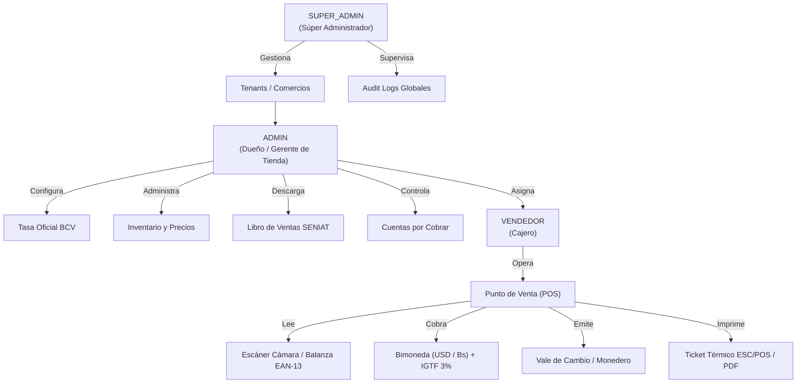

# 📖 Guía Maestra de Configuración a Producción, Credenciales, Accesos y Uso del Sistema Vuelto

Esta guía documenta integralmente la configuración del entorno de producción, la gestión de credenciales y seguridad, la matriz de accesos por rol y el manual de uso operativo de la plataforma **Vuelto** (SaaS Multi-Tenant de Facturación y Punto de Venta para Venezuela).

---

## 🌐 1. URLs y Endpoints de Producción

| Recurso | URL en Producción | Descripción |
|---|---|---|
| **Panel Web & POS** | `https://vuelto.onrender.com` | Interfaz web SPA (Login, POS, Inventario, Reportes) |
| **API REST Base** | `https://vuelto.onrender.com/api/v1` | Endpoints de negocio (autenticación, productos, ventas, etc.) |
| **Swagger UI (OpenAPI 3.0)** | `https://vuelto.onrender.com/api/docs` | Documentación interactiva de la API |
| **OpenAPI Spec (JSON)** | `https://vuelto.onrender.com/api/docs.json` | Especificación OpenAPI exportable |
| **Health Check Básico** | `https://vuelto.onrender.com/health` | Diagnóstico rápido de liveness y base de datos |
| **Health Check Liveness** | `https://vuelto.onrender.com/health/live` | Comprobación de estado activo del contenedor |
| **Health Check Readiness** | `https://vuelto.onrender.com/health/ready` | Verificación de conectividad a PostgreSQL |
| **Health Check Deep** | `https://vuelto.onrender.com/health/deep` | Diagnóstico exhaustivo de memoria, latencia y servicios |
| **Métricas Prometheus** | `https://vuelto.onrender.com/metrics` | Métricas estándar de Prometheus para Datadog/Grafana |

---

## ⚙️ 2. Variables de Entorno de Producción

En el panel de Render (o en tu orquestador Docker / Kubernetes), configura las siguientes variables en la sección **Environment**:

```env
# --- ENTORNO Y PUERTO ---
NODE_ENV=production
PORT=4000

# --- BASE DE DATOS POSTGRESQL (Supabase / Render Postgres) ---
# Requiere SSL obligatorio (?sslmode=require)
DATABASE_URL=postgresql://postgres:[PASSWORD]@[HOST]:5432/[DB_NAME]?sslmode=require

# --- SEGURIDAD CRIPTOGRÁFICA (Mínimo 32 caracteres aleatorios) ---
JWT_SECRET=genera_clave_aleatoria_hex_32_bytes_con_openssl
JWT_REFRESH_SECRET=genera_clave_aleatoria_refresh_32_bytes_con_openssl
JWT_ACCESS_EXPIRES_IN=15m
JWT_REFRESH_EXPIRES_IN=7d

# Clave AES-256 para cifrado en reposo (ej. secretos 2FA TOTP en base de datos)
ENCRYPTION_KEY=genera_clave_aes256_exactamente_32_caracteres_o_mas

# --- CORS & RED ---
ALLOWED_ORIGINS=https://vuelto.onrender.com,*

# --- PASARELA Y PAGOS ---
MOCK_PAYMENT_ENABLED=false

# --- OBSERVABILIDAD Y MONITOREO ---
METRICS_TOKEN=genera_token_seguro_para_scraping_de_metricas
LOG_LEVEL=info

# --- APROVISIONAMIENTO INICIAL (SEED SEGURO) ---
# Obligatorias en producción durante la primera migración; nunca uses valores por defecto
SEED_SUPERADMIN_USER=superadmin
SEED_SUPERADMIN_PASSWORD=TuSuperPassword2026!#UltraSegura
SEED_ADMIN_PASSWORD=TuAdminTienda2026!#UltraSegura
SEED_CASHIER_PASSWORD=TuCajero2026!#UltraSegura
```

> [!TIP]
> **Generación de Claves Criptográficas Seguras:**
> Puedes generar cadenas aleatorias seguras desde tu terminal ejecutando:
> ```bash
> openssl rand -hex 32
> ```

---

## 🔐 3. Credenciales, Seguridad y Rotación

### 3.1 Cuentas Creadas por Defecto tras el Seed

| Usuario (Username) | Rol del Sistema | Ámbito (Scope) | Propósito |
|---|---|---|---|
| `superadmin` | `SUPER_ADMIN` | Global de Plataforma | Control de Tenants (comercios), auditoría global y licencias |
| `admin` | `ADMIN` | Por Comercio (Tenant) | Dueño/Administrador de tienda (inventario, precios, BCV, cierres Z) |
| `cajero1` | `VENDEDOR` | Por Comercio (Tenant) | Cajero de mostrador (POS, escaneo, cobro y emisión de vales) |

### 3.2 Políticas de Seguridad Activas en Producción

1. **Hash de Contraseñas:** Se utiliza **Argon2id** (OWASP 2024: coste de memoria 19,456 KiB, 2 iteraciones, paralelismo 1). Los hashes existentes en bcrypt son migrados automáticamente en el siguiente inicio de sesión exitoso.
2. **Bloqueo de Cuentas (Account Lockout):** Si una cuenta acumula **5 intentos fallidos consecutivos**, se bloquea temporalmente durante **30 minutos**.
3. **Rotación de Refresh Tokens:** Los tokens de refresco son de un solo uso. Si se detecta la reutilización de un token revocado, el sistema revoca automáticamente toda la familia de sesiones activas del usuario (detección de robo de token).
4. **Segundo Factor de Autenticación (2FA TOTP):** Obligatorio para el rol `SUPER_ADMIN`. Se configura escaneando el código QR en aplicaciones compatibles (Google Authenticator, Microsoft Authenticator o Authy).

### 3.3 Rotación Directa de Contraseñas mediante SQL (Post-Instalación)

Si deseas actualizar manualmente la contraseña de cualquier usuario en PostgreSQL, puedes generar un hash Argon2id o bcrypt y ejecutar en el SQL Editor de Supabase:

```sql
-- Actualización segura de contraseña para un usuario específico
UPDATE users
SET 
  password_hash = '$argon2id$v=19$m=19456,t=2,p=1$...TU_NUEVO_HASH...',
  failed_login_attempts = 0,
  locked_until = NULL,
  updated_at = NOW()
WHERE username = 'superadmin';
```

---

## 👥 4. Matriz de Roles y Accesos



---

## 🖥️ 5. Manual Operativo de Uso

### 5.1 Flujo del Súper Administrador (`SUPER_ADMIN`)
1. **Inicio de Sesión:** Ingresa en `https://vuelto.onrender.com` con `superadmin`.
2. **Activación de 2FA TOTP:** En el primer acceso, navega a la sección de seguridad o consume `/api/v1/auth/setup-totp` para vincular tu app de autenticación móvil.
3. **Gestión de Comercios (Tenants):**
   - Crea un nuevo comercio indicando: Razón Social, RIF (con validador Módulo 11 venezolano: V, E, J, G, P), Dirección Fiscal y si es **Contribuyente Especial**.
   - Si un comercio presenta mora o irregularidades, puede suspenderse con un solo clic denegando el acceso a sus cajeros y administradores.

---

### 5.2 Flujo del Administrador del Negocio (`ADMIN`)
1. **Configuración Inicial del Negocio:**
   - Define el nombre comercial y logo del ticket.
   - Activa la tasa oficial del **Banco Central de Venezuela (BCV)**. El sistema sincroniza la tasa automáticamente o permite ajuste manual protegido con auditoría.
2. **Gestión de Inventario:**
   - Agrega productos con sus códigos de barra (EAN-13, Code128, etc.).
   - Asigna la alícuota de IVA correspondiente:
     - **16% (General):** Mayoría de productos de consumo.
     - **8% (Reducida):** Bienes regulados.
     - **0% (Exenta):** Alimentos de la canasta básica (harina, arroz, leche, etc.).
   - Define el precio de venta en USD (el sistema calculará en tiempo real el precio en Bs según la tasa vigente).
3. **Descarga de Reportes Fiscales SENIAT:**
   - Al finalizar el mes, ve al menú **Reportes** ➔ **Libro de Ventas SENIAT**.
   - Descarga el reporte oficial en formato CSV (con codificación UTF-8 y BOM `\uFEFF` para compatibilidad nativa con Microsoft Excel en español). Cumple estrictamente con la **Providencia SENIAT N° 0071**.

---

### 5.3 Flujo del Cajero en Punto de Venta (`VENDEDOR` / POS)

#### A. Búsqueda y Escaneo de Productos
* **Escaneo con Cámara de Teléfono:**
  1. En la app móvil o interfaz táctil, toca el botón con el ícono **📷 (Cámara)**.
  2. Apunta hacia el código de barras del producto.
  3. El sistema emitirá un beep sonoro, vibración táctil y un destello verde confirmando el escaneo.
  4. Si el producto ya está en el carrito, incrementa automáticamente la cantidad.
  5. Si el producto no existe en el catálogo, se despliega la opción rápida **"Crear Producto"** con el código prellenado.
* **Soporte de Balanzas de Carnicería y Charcutería (EAN-13):**
  * Si el código escaneado comienza con prefijos **20**, **21** o **22**, el decodificador integrado desglosa automáticamente el código del producto y el peso exacto en kilogramos o el precio total pesado.

#### B. Cuentas Abiertas Simultáneas (Held Carts)
* Si un cliente debe esperar o buscar otro producto en el pasillo, el cajero puede pausar la venta en una de las **10 cuentas en espera simultáneas** sin perder los artículos escaneados y atender al siguiente cliente.

#### C. Cobro Bimoneda y Percepción de IGTF (3%)
* La pantalla de cobro muestra instantáneamente el total en **Dólares ($)** y en **Bolívares (Bs)**.
* **Múltiples métodos de pago combinados:** El cliente puede pagar una parte en Bolívares (Pago Móvil / Tarjeta de Débito) y el restante en Divisas en efectivo ($).
* **Cálculo automático de IGTF:** Si el comercio está configurado como Contribuyente Especial, el sistema calcula de manera exacta el **3% de IGTF** únicamente sobre la porción pagada en divisas en efectivo, desglosándolo en el comprobante fiscal.

#### D. Manejo Inteligente de Vuelto (El Problema de la Falta de Cambio)
Cuando no hay cambio exacto en efectivo en la gaveta, el sistema ofrece 3 alternativas:
1. **Efectivo en Bolívares:** Entrega del cambio al cliente según la tasa del momento.
2. **Saldo a Favor en Cuenta Corriente:** Si el cliente está registrado con su Cédula/RIF, el vuelto se acredita a su monedero para su próxima compra.
3. **Emisión de Vale de Cambio Térmico:** Se imprime un ticket con un código QR / código de barras único canjeable en compras futuras.

#### E. Impresión Térmica y Entrega de Comprobante
* **Impresoras Térmicas Bluetooth / ESC-POS:** Compatible con rollos de **58 mm (32 columnas)** y **80 mm (48 columnas)**.
* **Apertura de Gaveta de Dinero:** Si la venta incluye efectivo, el sistema envía automáticamente el pulso eléctrico RJ11 (`0x1B, 0x70`) para abrir la gaveta monedero.
* **Comprobante Digital:** Opción de compartir el PDF oficial de la factura directamente por WhatsApp, Telegram o correo electrónico.

#### F. Operación Offline (Sin Internet)
* Si se interrumpe la conexión a internet en el local:
  1. La aplicación móvil continúa operando usando la base de datos local SQLite (`expo-sqlite`).
  2. Las ventas quedan almacenadas de forma segura en la cola local de pendientes.
  3. Al restablecerse la conexión, el servicio `/api/v1/sales/sync-batch` procesa las ventas de forma idempotente sin duplicar números de factura ni saltos correlativos.

---

## 🛠️ 6. Diagnóstico y Monitoreo en Producción

### 6.1 Comprobación Rápida con cURL
```bash
# 1. Comprobar estado de salud general
curl -i https://vuelto.onrender.com/health

# 2. Comprobar conectividad a la base de datos PostgreSQL
curl -i https://vuelto.onrender.com/health/ready

# 3. Consultar métricas de Prometheus (requiere METRICS_TOKEN)
curl -i -H "x-metrics-token: TU_METRICS_TOKEN" https://vuelto.onrender.com/metrics
```

### 6.2 Registros y Auditoría de Seguridad
Cada inicio de sesión, bloqueo de cuenta, modificación de precios, cambio de tasa BCV o anulación de factura queda registrado permanentemente en la tabla `audit_logs` con dirección IP, agente de usuario, identificador de comercio y estado del resultado (`SUCCESS` o `REJECTED`).

---

## 🚨 7. Contacto de Soporte y Seguridad

* **Reporte de Incidentes de Seguridad:** Consulta [`docs/SECURITY.md`](SECURITY.md) para conocer el protocolo de divulgación coordinada (SLA de respuesta: 72 horas).
* **Guía de Desastre y Recuperación:** Consulta [`docs/DR_RUNBOOK.md`](DR_RUNBOOK.md) para procedimientos de restauración de base de datos ante incidentes mayores.
