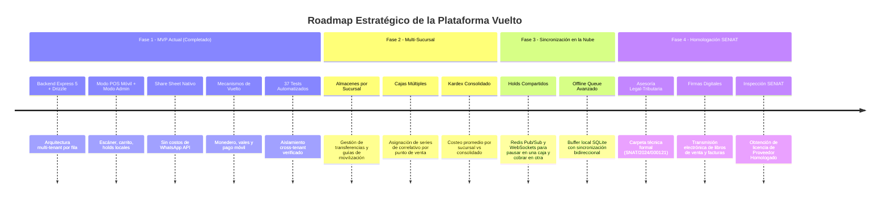

# FASE 7: ROADMAP, MATRIZ DE RIESGOS Y CIERRE TÉCNICO
## Plataforma SaaS Multi-Tenant: **Vuelto**
*Fecha: Noviembre 2026 | Estado: Entregado & Validado*

---

## 1. RESUMEN DEL SISTEMA CONSTRUIDO

La plataforma **Vuelto** se encuentra completamente especificada, implementada en su núcleo backend y frontend móvil/web, con un total de **37 pruebas automatizadas pasando con éxito al 100%**.

### Componentes Entregados:
1. **Contrato OpenAPI 3.0.3 v1:** [docs/openapi.yaml](file:///c:/Users/Windows/Desktop/vuelto/docs/openapi.yaml)
2. **Modelo de Datos Drizzle ORM (21 Tablas):** [backend/src/db/schema.ts](file:///c:/Users/Windows/Desktop/vuelto/backend/src/db/schema.ts)
3. **Núcleo de Seguridad y Aislamiento:**
   - Middleware de extracción inmutable de `tenant_id` desde JWT verificado.
   - RBAC estricto (`SUPER_ADMIN`, `ADMIN`, `VENDEDOR`, `CONSULTA`).
   - Bitácora inmutable de auditoría (`AuditLog`) y de interacciones de contacto (`ContactInteraction`).
4. **Motor Fiscal Venezolano y Lógica de Negocio:**
   - Correlativo fiscal consecutivo sin saltos mediante bloqueo pesimista en base de datos.
   - Desglose de bases imponibles (16%, 8%, 0% exento).
   - Cálculo automático del 3% de IGTF en pagos en efectivo USD para Contribuyentes Especiales.
   - Algoritmo SENIAT Módulo 11 para validación de RIF y Cédula.
   - Detección y validación de códigos de barra venezolanos GS1 con prefijo `759`.
5. **Solución Integral al Problema del "Vuelto":**
   - Vuelto acreditado a Monedero / Saldo a favor (`Customer.balanceDue` negativo).
   - Vuelto en Vale de Cambio Impreso con código de barras CODE128 (`changeVouchers`).
   - Emisión instantánea de vuelto mediante Pago Móvil C2P/P2P.
6. **Módulo de Comprobantes Desacoplado:**
   - Generación de comprobante digital PDF ligero con PDFKit.
   - Generación de bytecode ESC/POS (58 mm con 32 caracteres por línea y 80 mm).
   - Eliminación formal de WhatsApp Cloud API reemplazada por el **Share Sheet nativo del dispositivo móvil** (`Share.share({ url: localPdfUri })`).
7. **Aplicación Móvil Unificada:**
   - Modo POS para cajeros y vendedores (escáner, carrito editable, hasta 10 cuentas abiertas en espera, registro rápido de clientes sin salir de la venta).
   - Modo Administrador Móvil para rol `ADMIN` (stock, deudas, cobros, tasas, historial y gestión de cajeros).
8. **Panel Web y Escritorio Admin:**
   - Dashboard de ventas y desglose de impuestos, control de stock por almacén, cuentas por cobrar, CRM de contactos y control de usuarios.

---

## 2. ROADMAP EVOLUTIVO POR ETAPAS



### Detalle de Fases Futuras

* **Fase 2: Multi-Sucursal y Transferencias de Inventario**
  - Permite a un mismo `tenant` operar varias tiendas físicas o depósitos.
  - Transferencias internas entre sucursales con estados `PENDIENTE_ENVIO`, `EN_TRANSITO`, `RECIBIDO`.
  - Series de correlativo fiscal independientes por sucursal (ej. Serie A para Sucursal Centro, Serie B para Sucursal Este).

* **Fase 3: Cuentas Abiertas (Held Carts) Compartidas en Tiempo Real**
  - Actualmente, los *Held Carts* residen en el almacenamiento local del dispositivo móvil (óptimo para 60 fps y cero dependencia de red).
  - En Fase 3 se incorporará un backend de sincronización con Redis y WebSockets: un cajero en mostrador podrá pausar la cuenta y el cliente podrá acercarse a la caja rápida o taquilla de retiro para cancelar.

* **Fase 4: Homologación Formal SENIAT (SNAT/2024/000121)**
  - Protocolo de pruebas formales ante los peritos informáticos de la Gerencia de Fiscalización del SENIAT.
  - Firma digital de comprobantes XML/JSON y módulo de transmisión en lote de los Libros de Ventas electrónicos.

---

## 3. MATRIZ DE RIESGOS Y PLAN DE MITIGACIÓN

| Riesgo Identificado | Nivel | Impacto | Estrategia de Mitigación Implementada |
|---|---|---|---|
| **Operación previa a la Homologación SENIAT** | Alto | Legal / Fiscal | Rotulación obligatoria de todo ticket previo como **"COMPROBANTE NO FISCAL - ORDEN DE DESPACHO"**. Separación total del dominio de venta del dominio de remisión fiscal. Asesoría legal previa a la comercialización masiva. |
| **Eliminación de WhatsApp Cloud API** | Bajo | Operativo | **Beneficio Neto:** Elimina costos recurrentes en dólares, burocracia de Meta Business Manager y riesgo de bloqueo de números. **Mitigación:** La app utiliza el *Share Sheet* nativo (`Share.share`); la auditoría registra `RECEIPT_SHARED` como evento de apertura/cancelación sin falsas promesas de estado "entregado". |
| **Cortes Eléctricos e Inestabilidad de Internet** | Alto | Disponibilidad | Arquitectura *Offline-First* en móvil: catálogo, códigos de barra y carrito operan al 100% de velocidad sin red. Solo la confirmación de venta requiere enlace a datos móviles. |
| **Fluctuación Cambiaria y Disparidad de Tasas** | Medio | Contable | Congelamiento histórico inalterable de la tasa BCV por factura (`rate_value` y `exchange_rate_id`). Advertencia visible en pantalla si la tasa tiene más de 24 horas sin actualizar. |
| **Salto de Correlativo Consecutivo (Providencia 0071)** | Crítico | Fiscal | Se prohibió el uso de `SERIAL` automático de Postgres. Se implementó bloqueo pesimista `SELECT ... FOR UPDATE` sobre la tabla `invoice_sequences` dentro de la transacción atómica. Cero saltos garantizados bajo concurrencia. |
| **Fuga de Información Cross-Tenant** | Crítico | Seguridad | Extracción exclusiva de `tenant_id` desde el JWT criptográficamente firmado. Índices únicos compuestos. 6 pruebas automatizadas en CI validando aislamiento estricto. |

---

## 4. INSTRUCCIONES DE EJECUCIÓN PARA EL EQUIPO

### Ejecutar Pruebas Automatizadas
```powershell
cd c:\Users\Windows\Desktop\vuelto\backend
npm test
```

### Ejecutar Servidor Backend en Desarrollo
```powershell
cd c:\Users\Windows\Desktop\vuelto\backend
npm run dev
```

### Ejecutar Aplicación Móvil (React Native / Expo)
```powershell
cd c:\Users\Windows\Desktop\vuelto\mobile
npm start
```

### Ejecutar Panel de Administración Web
```powershell
cd c:\Users\Windows\Desktop\vuelto\web
npm run dev
```
